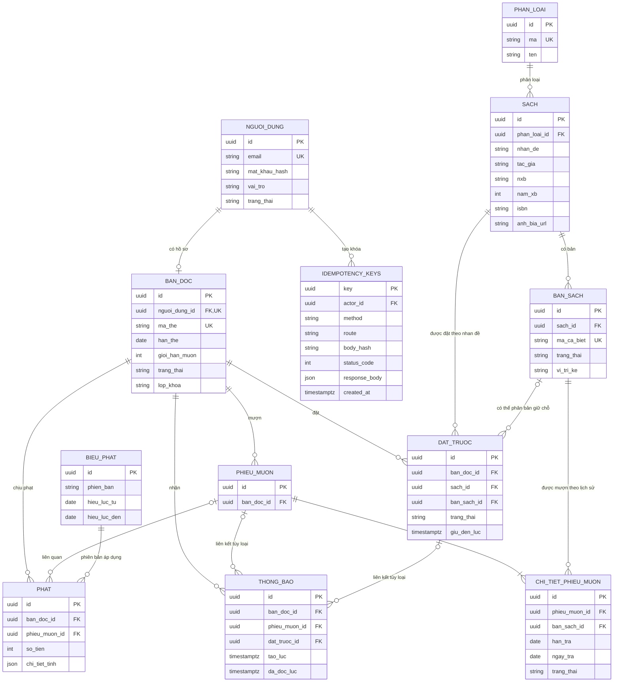

# Hồ sơ phân tích và thiết kế nền tảng Backend

> **Đề 21 – INT4211 · Tuần 9 · LIB21-v1**  
> **Tác giả/phụ trách:** Nguyễn Đức Quang (Người 1 – Backend nền tảng)  
> **Trạng thái:** Bản nháp để review; chưa xác nhận là bản đã được nhóm trưởng/giảng viên duyệt.

## Phạm vi và trạng thái

Tài liệu tổng hợp các đầu ra D.3 tuần 9 (Use Case, ERD/CSDL, bảng phân công), kèm ghi chú nền tảng về dữ liệu, API/JSON và kiến trúc. Đây là bản nháp để nhóm trưởng tổng hợp và nhóm review.

| Nhóm nội dung | Phạm vi | Trạng thái |
|---|---|---|
| Bắt buộc D.3 | Sơ đồ Use Case chung (tác nhân, chức năng, quyền); ERD nháp toàn hệ thống; bảng phân công | Bản nháp |
| Hỗ trợ nội bộ | Từ điển dữ liệu, ràng buộc, API/JSON mẫu, kiến trúc, các điểm cần chốt | Đề xuất, cần review |
| Chưa phải bằng chứng hoàn thành | Code backend, schema chạy thật, deploy Render, kiểm thử tích hợp, APK | Không xác nhận đã hoàn tất |

Tuần 9 ưu tiên phân tích và thiết kế. Không suy diễn backend, deploy, kiểm thử, APK hoặc endpoint đã hoàn thành. Các yêu cầu P1-W9-01 đến P1-W9-08 được nêu theo tài liệu đầu vào của nhóm và hợp đồng LIB21-v1.

## 1. Phạm vi Người 1 và ranh giới với Người 2

- **Người 1 – Nguyễn Đức Quang:** nền tảng Backend, dữ liệu nền tảng và tổng hợp ERD cùng Người 2.
- **Người 2 – Võ Văn Quốc Bảo:** nhóm trưởng/Coordinator, nghiệp vụ lưu thông và xác nhận thiết kế chung.

| Người 1 – nền tảng | Người 2 – nghiệp vụ | Điểm giao tiếp bắt buộc |
|---|---|---|
| Node.js/Express; cấu hình/hạ tầng chung; Auth/JWT; phân quyền/middleware; danh mục; nhan đề sách; bản sách; hồ sơ bạn đọc/thẻ; Storage ảnh bìa; thiết kế DB nền tảng; migration nền tảng | Mượn/trả; phiếu mượn; đặt trước; giữ chỗ; gia hạn; phạt; biểu phạt; báo cáo; thông báo; jobs và chuyển trạng thái lưu thông | Một backend Express và một PostgreSQL Supabase dùng chung. Người 1 không tự quyết định hoặc sửa quy tắc chuyển trạng thái `DANG_MUON`/`GIU_CHO`; Người 2 xác nhận nghiệp vụ và bảng liên quan. |

Người 3 (Võ Anh Lộc) cần API/dữ liệu cho Android Admin; Người 4 (Huỳnh Triệu Hào) cần API/dữ liệu cho Flutter Client. Cả hai review tên trường, enum, nullability, phân trang và trạng thái.

## 2. Use Case chung – bản nháp

Tác nhân chính: `ADMIN`, `THU_THU` và `BAN_DOC`. Khách chưa xác thực là trạng thái truy cập trước đăng nhập/đăng ký. Đăng ký bạn đọc tạo tài khoản vai trò `BAN_DOC` và hồ sơ thẻ `CHO_DUYET`; luồng này khác với ADMIN tạo tài khoản nhân viên.

| Tác nhân | Use case nền tảng | Quyền và giới hạn |
|---|---|---|
| Khách chưa xác thực | Đăng ký bạn đọc; đăng nhập | Chỉ gọi chức năng công khai; không truy cập dữ liệu riêng tư trước xác thực. |
| `BAN_DOC` | Đăng nhập/đăng xuất; xem hồ sơ và thẻ; tra cứu phân loại/nhan đề; xem chi tiết sách, ảnh bìa, vị trí kệ, bản rảnh | Thẻ `CHO_DUYET` vẫn được đăng nhập và tra cứu; chưa được đặt trước/gia hạn. Thẻ `BINH_THUONG` thao tác theo cờ và điều kiện Backend. |
| `THU_THU` | Đăng nhập; quản lý hồ sơ bạn đọc/thẻ; duyệt/cập nhật trạng thái thẻ; quản lý phân loại, nhan đề, bản sách; cập nhật ảnh bìa; thao tác nghiệp vụ theo quyền | Không quản trị tài khoản/role nhân viên khác nếu chưa được ADMIN cấp quyền. |
| `ADMIN` | Chức năng quản trị được phân quyền; quản lý tài khoản nhân viên; tạo/sửa/khóa tài khoản `THU_THU`; quản lý quyền và dữ liệu nền tảng | Có quyền quản lý nhân viên khác `THU_THU`; hành động quản trị cần audit/kiểm soát. |

Các nghiệp vụ mượn/trả, đặt trước, gia hạn, tính phạt, báo cáo và thông báo do Người 2 đặc tả trong sơ đồ chung; phần này chỉ liên kết với dữ liệu nền tảng.

### 2.1 Danh sách Use Case

- **UC-A01 Đăng ký bạn đọc** (khách): tạo `nguoi_dung` với `vai_tro=BAN_DOC` và `ban_doc` trạng thái `CHO_DUYET`.
- **UC-A02 Đăng nhập/xác thực phiên**: phát JWT; kiểm tra vai trò và trạng thái tài khoản.
- **UC-A03 Quản lý tài khoản nhân viên** (ADMIN): tạo/cập nhật/khóa tài khoản `THU_THU`; quản lý quyền.
- **UC-A04 Quản lý danh mục** (`THU_THU`/ADMIN theo quyền).
- **UC-A05 Quản lý nhan đề sách** (`THU_THU`/ADMIN theo quyền): metadata, ISBN, ảnh bìa, phân loại.
- **UC-A06 Quản lý bản sách** (`THU_THU`/ADMIN theo quyền): mã cá biệt, trạng thái bản, vị trí kệ.
- **UC-A07 Quản lý hồ sơ bạn đọc/thẻ** (`THU_THU`/ADMIN theo quyền): duyệt thẻ, cấp mã thẻ, hạn thẻ, giới hạn mượn.
- **UC-A08 Tra cứu sách, xem chi tiết/vị trí kệ** (`BAN_DOC`, nhân viên theo quyền).
- **UC-A09 Xem hồ sơ/thẻ của tôi** (`BAN_DOC`).
- **UC-A10 Mượn/trả, đặt trước, gia hạn, phạt, báo cáo, thông báo**: Người 2 phụ trách; liên kết tới `ban_doc`, `sach`, `ban_sach`, `nguoi_dung`.

### 2.2 Luồng đăng ký và duyệt thẻ

1. Khách gửi email, mật khẩu, họ tên, lớp/khoa qua `POST /auth/dang-ky`.
2. Backend tạo `nguoi_dung` với `vai_tro=BAN_DOC`, tạo `ban_doc` ở trạng thái `CHO_DUYET`; `han_the` là `NULL` trước khi duyệt.
3. `THU_THU`/ADMIN có quyền duyệt hồ sơ; khi duyệt mới cấp `ma_the`, `han_the`, `gioi_han_muon` theo quy tắc nhóm trưởng xác nhận.
4. `BAN_DOC` có thể đăng nhập và tra cứu khi `CHO_DUYET`; Backend từ chối đặt trước/gia hạn cho tới khi thẻ hợp lệ.

## 3. ERD nháp toàn hệ thống

Mô hình tổng hợp đề xuất. Bảng nghiệp vụ được đưa vào để thể hiện một nhan đề có nhiều bản sách, phiếu mượn gắn với bản sách, còn đặt trước gắn với nhan đề. Người 2 xác nhận bảng/cột nghiệp vụ; Người 1 tổng hợp và chuẩn hóa nền tảng.



### 3.1 Bảng và khóa

| Bảng | PK, FK, unique chính | Vai trò dữ liệu |
|---|---|---|
| `nguoi_dung` | PK `id` UUID; UQ `email`; `vai_tro`, `trang_thai` | Tài khoản xác thực `ADMIN`/`THU_THU`/`BAN_DOC`; không chứa toàn bộ hồ sơ thẻ. |
| `ban_doc` | PK `id`; FK `nguoi_dung_id` → `nguoi_dung.id` (UQ); UQ `ma_the` | Hồ sơ bạn đọc/thẻ; `han_the` nullable khi `CHO_DUYET`; lớp/khoa, giới hạn mượn, trạng thái. |
| `phan_loai` | PK `id`; UQ `ma` | Danh mục phân loại sách. |
| `sach` | PK `id`; FK `phan_loai_id` → `phan_loai.id` | Nhan đề/metadata: `nhan_de`, `tac_gia`, `nxb`, `nam_xb`, `isbn`, `anh_bia_url`. |
| `ban_sach` | PK `id`; FK `sach_id` → `sach.id`; UQ `ma_ca_biet` | Từng bản vật lý của nhan đề; trạng thái và vị trí kệ. |
| `phieu_muon` | PK `id`; FK `ban_doc_id` → `ban_doc.id` | Phiếu/đợt mượn; chi tiết nghiệp vụ do Người 2 chốt. |
| `chi_tiet_phieu_muon` | PK `id`; FK `phieu_muon_id` → `phieu_muon.id`; FK `ban_sach_id` → `ban_sach.id` | Dòng mượn gắn một bản sách; có `han_tra`, `ngay_tra`, trạng thái dòng. |
| `dat_truoc` | PK `id`; FK `ban_doc_id`, `sach_id`; FK nullable `ban_sach_id` | Đặt trước gắn nhan đề; có thể gắn bản sách khi chuyển giữ chỗ; `giu_den_luc` là thời điểm. |
| `phat` | PK `id`; FK `ban_doc_id`; FK nullable `phieu_muon_id` | Khoản phạt; lưu số tiền và `chi_tiet_tinh`/phiên bản biểu phạt để bảo toàn lịch sử. |
| `bieu_phat` | PK `id` | Biểu phạt có phiên bản và khoảng hiệu lực; cấu trúc chi tiết do Người 2 xác nhận. |
| `thong_bao` | PK `id`; FK `ban_doc_id`; FK nullable `phieu_muon_id`/`dat_truoc_id` | Thông báo tới bạn đọc; thời điểm tạo/đọc và liên kết nghiệp vụ tùy loại. |
| `idempotency_keys` | PK `key` UUID; FK `actor_id` → `nguoi_dung.id` | Chống xử lý lặp yêu cầu ghi; lưu method, route, body hash, status, response và thời điểm tạo. |

### 3.2 Quan hệ và lực lượng

| Quan hệ | Lực lượng | Diễn giải |
|---|---:|---|
| `nguoi_dung` – `ban_doc` | 1 – 0..1 | Tài khoản `BAN_DOC` có tối đa một hồ sơ; nhân viên không cần hồ sơ `ban_doc`. |
| `phan_loai` – `sach` | 1 – N | Một phân loại có nhiều nhan đề; `phan_loai_id` nullable nếu cho phép sách chưa phân loại (cần chốt). |
| `sach` – `ban_sach` | 1 – N | Một nhan đề có nhiều bản sách vật lý. |
| `ban_doc` – `phieu_muon` | 1 – N | Một bạn đọc có nhiều phiếu theo thời gian. |
| `phieu_muon` – `chi_tiet_phieu_muon` | 1 – N | Một phiếu có nhiều dòng mượn. |
| `ban_sach` – `chi_tiet_phieu_muon` | 1 – N theo lịch sử | Một bản xuất hiện trong nhiều dòng ở các thời điểm; không cho mượn đồng thời nếu trạng thái không hợp lệ. |
| `ban_doc` – `dat_truoc`; `sach` – `dat_truoc` | 1 – N | Đặt trước thuộc bạn đọc và nhan đề; `ban_sach_id` nullable trước khi phân bản giữ chỗ. |
| `ban_doc` – `phat`/`thong_bao` | 1 – N | Một bạn đọc có nhiều khoản phạt và thông báo. |
| `nguoi_dung` – `idempotency_keys` | 1 – N | Mỗi actor có nhiều khóa idempotency. |

### 3.3 Nguyên tắc thiết kế

- Tách tài khoản `nguoi_dung` khỏi hồ sơ `ban_doc`, liên kết 1–0..1 bằng `ban_doc.nguoi_dung_id`.
- Một nhan đề `sach` có nhiều `ban_sach`; không gộp bản vật lý vào bảng `sach`.
- Chi tiết phiếu mượn tham chiếu `ban_sach_id`; đặt trước tham chiếu `sach_id`, không chỉ một bản cụ thể.
- `ban_sach.trang_thai` và `dat_truoc.trang_thai` là trạng thái lưu thông; Người 1 không tự thay quy tắc chuyển `DANG_MUON`/`GIU_CHO`; Người 2 chịu trách nhiệm nghiệp vụ.
- Đưa `thong_bao` và `idempotency_keys` vào ERD tổng hợp dù có thể không nằm trong danh sách tối thiểu ban đầu.

## 4. Từ điển dữ liệu và ràng buộc

| Quy ước | Quy định đề xuất |
|---|---|
| Định danh | UUID trong PostgreSQL; biểu diễn dạng chuỗi ở API. |
| Tên bảng/cột | `snake_case` trong DB; JSON dùng `camelCase`. |
| Email | `nguoi_dung.email` NOT NULL, UNIQUE; trim và chuẩn hóa chữ thường trước khi lưu. |
| Mã thẻ | `ban_doc.ma_the` UNIQUE; có thể NULL trước duyệt nếu cấp mã sau duyệt. |
| Mã cá biệt | `ban_sach.ma_ca_biet` UNIQUE, NOT NULL sau khi tạo bản sách. |
| Enum vai trò | `ADMIN`, `THU_THU`, `BAN_DOC`. |
| Enum thẻ | `CHO_DUYET`, `BINH_THUONG` và trạng thái khóa/ngưng theo hợp đồng cần nhóm xác nhận. |
| Ngày nghiệp vụ | `han_the`, `han_tra`, `ngay_muon`, `ngay_tra` dùng DATE nếu chỉ biểu diễn ngày. |
| Thời điểm | `giu_den_luc`, `tao_luc`, `huy_luc`, `hoan_tac_den_luc` dùng TIMESTAMPTZ. |
| Nullable | `han_the` NULL khi `CHO_DUYET`; `dat_truoc.ban_sach_id` NULL trước phân bản; FK liên kết thông báo có thể NULL tùy loại. |
| Bảo mật | Không lưu mật khẩu thuần; chỉ lưu `mat_khau_hash`. JWT `sub` là `nguoi_dung.id`. |
| Quyền cập nhật | Người 1 quản lý metadata/dữ liệu nền tảng; Người 2 kiểm soát chuyển trạng thái lưu thông và nghiệp vụ. |

Cần chốt ISBN có bắt buộc/duy nhất hay không (có thể có nhiều ấn bản/định dạng), tên enum chính thức cho trạng thái bản sách/phiếu mượn/đặt trước, và chính sách xóa mềm hay khóa bản ghi.

## 5. API nền tảng và JSON mẫu

Các endpoint dưới đây là thiết kế dự kiến theo prefix `/api/v1`, không phải bằng chứng endpoint đã triển khai/chạy. Envelope dự kiến: `{ data, meta, error }`.

| Method/endpoint | Vai trò gọi | Mục đích và dữ liệu chính |
|---|---|---|
| `POST /api/v1/auth/dang-ky` | Khách | Đăng ký bạn đọc; `email`, `matKhau`, `hoTen`, `lopKhoa`. |
| `POST /api/v1/auth/dang-nhap` | Khách | Đăng nhập; trả token, expiresAt, nguoiDung. |
| `GET /api/v1/auth/toi` | JWT mọi vai trò | Tài khoản hiện tại, `vaiTro`, `banDocId` nullable. |
| `GET /api/v1/phan-loai` | Đã xác thực | Danh sách phân loại; có thể phân trang `page/pageSize`. |
| `GET /api/v1/sach` | Đã xác thực | Tra cứu nhan đề; `tuKhoa`, `phanLoai`, `page`, `pageSize`; tổng số trong meta. |
| `GET /api/v1/sach/:id` | Đã xác thực | Chi tiết nhan đề, ảnh bìa, số bản rảnh, vị trí kệ, cờ nghiệp vụ. |
| `GET /api/v1/ban-doc/toi` | `BAN_DOC` | Hồ sơ/thẻ bạn đọc hiện tại. |
| `POST /api/v1/sach` | `THU_THU`/ADMIN theo quyền | Tạo nhan đề; endpoint dự kiến cho app quản trị. |
| `POST /api/v1/ban-sach` | `THU_THU`/ADMIN theo quyền | Tạo bản vật lý gắn nhan đề. |
| `POST /api/v1/uploads/anh-bia` | `THU_THU`/ADMIN theo quyền | Upload ảnh bìa lên Storage; trả URL. |
| `PATCH /api/v1/ban-doc/:id` | `THU_THU`/ADMIN theo quyền | Duyệt/cập nhật thẻ; quy tắc trạng thái cần nhóm trưởng xác nhận. |

### 5.1 Ví dụ JSON

**Đăng ký bạn đọc – request**

```json
{
  "email": "sinhvien@example.edu.vn",
  "matKhau": "********",
  "hoTen": "Nguyen Van A",
  "lopKhoa": "CNTT K..."
}
```

**Đăng ký thành công – response**

```json
{
  "data": {
    "id": "uuid-user",
    "email": "sinhvien@example.edu.vn",
    "hoTen": "Nguyen Van A",
    "vaiTro": "BAN_DOC",
    "banDoc": { "id": "uuid-reader", "trangThai": "CHO_DUYET", "hanThe": null }
  },
  "meta": null,
  "error": null
}
```

**Đăng nhập – response**

```json
{
  "data": {
    "token": "<JWT>",
    "expiresAt": "2026-11-06T12:00:00Z",
    "nguoiDung": { "id": "uuid-user", "hoTen": "Nguyen Van A", "vaiTro": "BAN_DOC" }
  },
  "meta": null,
  "error": null
}
```

**Danh sách sách – response**

```json
{
  "data": [{
    "id": "uuid-book",
    "nhanDe": "Lap trinh Flutter",
    "tacGia": "Tac gia A",
    "anhBiaUrl": null,
    "soBanRanh": 2
  }],
  "meta": { "page": 1, "pageSize": 20, "total": 1 },
  "error": null
}
```

**Chi tiết sách – response**

```json
{
  "data": {
    "id": "uuid-book",
    "nhanDe": "Lap trinh Flutter",
    "tacGia": "Tac gia A",
    "nxb": "NXB X",
    "namXb": 2025,
    "isbn": null,
    "anhBiaUrl": "https://storage.example/cover.jpg",
    "soBanRanh": 0,
    "viTriKe": ["Ke A1 - Tang 1"],
    "coTheDatTruoc": true,
    "lyDoKhongTheDatTruoc": null
  },
  "meta": null,
  "error": null
}
```

**Lỗi chuẩn – response**

```json
{
  "data": null,
  "meta": null,
  "error": { "code": "VALIDATION_ERROR", "message": "Email da ton tai", "details": [] }
}
```

### 5.2 Quy tắc phản hồi và lỗi

- HTTP `200`/`201`: thành công; `400`: dữ liệu không hợp lệ; `401`: thiếu/hết hạn JWT; `403`: sai vai trò/quyền; `404`: không tìm thấy; `409`: xung đột nghiệp vụ; `500`: lỗi máy chủ.
- Không gửi mật khẩu hoặc `mat_khau_hash` trong response. Token truyền qua `Authorization: Bearer <JWT>`.
- Danh sách dùng `data` là mảng và `meta` gồm `page`, `pageSize`, `total`. Dữ liệu không có dùng `null` hoặc `[]` theo kiểu trường đã thống nhất.
- Backend là nguồn sự thật cho `soBanRanh`, `coTheDatTruoc`, `biChanMuon`, `coTheGiaHan` và lý do từ chối. Client không tự tính tồn kho hoặc tự chuyển trạng thái.
- Mutation quan trọng dùng `Idempotency-Key` UUID; lỗi `409` trả thông báo rõ và Client tải lại dữ liệu.

## 6. Bảng phân công và phần việc Người 1

| Thành viên/vai trò | Nhiệm vụ | Đầu ra chính | Mốc dự kiến/review |
|---|---|---|---|
| **Nguyễn Đức Quang – Người 1** | Backend nền tảng; Auth/JWT; role middleware; danh mục; sách/bản sách; bạn đọc/thẻ; Storage; schema nền tảng; tổng hợp ERD; cấu hình server chung. | Use Case nền tảng; ERD nguồn và bản xuất; data dictionary; API/JSON nền tảng; backend nền tảng; migrations; deploy backend. | Tuần 9 phân tích; tuần 10 khung/Auth/Catalog; tuần 11 deploy và tối thiểu 3 API thật; phối hợp Bảo, Lộc, Hào. |
| **Võ Văn Quốc Bảo – Người 2/nhóm trưởng** | Điều phối; nghiệp vụ mượn/trả, đặt trước, phạt, báo cáo, thông báo, jobs; review ERD/API; tổng hợp/nộp D.3. | Bảng nghiệp vụ; quy tắc trạng thái; Use Case nghiệp vụ; xác nhận ERD; bảng phân công toàn nhóm; bản nộp giảng viên. | Tuần 9 review/chốt; tuần 10–11 nghiệp vụ backend; duyệt tài liệu và mốc. |
| **Võ Anh Lộc – Người 3** | Android Admin Java/XML; review Use Case Admin; wireframe; quyền thao tác quản trị; dữ liệu sách/bản sách/thẻ và API. | Use Case Admin; Android skeleton rồi màn hình quản trị ưu tiên; review API/JSON. | Tuần 9 góp ý; tuần 10 skeleton; tuần 11 theo mốc app và tích hợp. |
| **Huỳnh Triệu Hào – Người 4** | Flutter Client Dart; review luồng đăng ký, tra cứu, hồ sơ; ánh xạ API/ERD sang 9 màn hình bạn đọc. | Use Case `BAN_DOC`; wireframe 9 màn hình; API mapping; model/JSON review; Flutter Client. | Tuần 9 phân tích; tuần 10 skeleton/network/session/models; tuần 11 hai màn hình ưu tiên gọi API thật. |

### 6.1 WBS Người 1 theo P1-W9

| Mã | Công việc | Đầu ra/tiêu chí | Phối hợp |
|---|---|---|---|
| P1-W9-01 | Đọc đề, xác định phạm vi nền tảng và ranh giới Người 2. | Danh sách auth/catalog/readers/storage/hạ tầng; không mơ hồ chủ sở hữu. | Bảo xác nhận; Lộc/Hào góp nhu cầu. |
| P1-W9-02 | Góp Use Case nền tảng và ma trận quyền. | Tác nhân ADMIN/THU_THU/BAN_DOC; tách đăng ký bạn đọc và tạo tài khoản nhân viên. | Bảo tổng hợp; Lộc/Hào review. |
| P1-W9-03 | Vẽ ERD nền tảng, nhận bảng nghiệp vụ, ghép ERD chung. | Ít nhất 8 bảng; PK/FK/cardinality; bản nguồn chỉnh sửa và bản xuất đọc được. | Bảo đồng thiết kế nghiệp vụ. |
| P1-W9-04 | Từ điển dữ liệu/ràng buộc. | UUID, snake_case/camelCase, enum, DATE/TIMESTAMPTZ, unique/nullability, quyền sửa. | Bảo xác nhận trạng thái. |
| P1-W9-05 | API nền tảng và JSON mẫu. | Đăng nhập, sách, bản sách, thẻ; data/meta/error; phân trang; vai trò gọi. | Bảo bổ sung nghiệp vụ; Lộc/Hào review. |
| P1-W9-06 | Điền phần Người 1 vào phân công và phụ thuộc. | Hợp đồng, khung chung, auth, catalog, readers, DB, deploy, bàn giao. | Bảo xác nhận toàn nhóm. |
| P1-W9-07 | Kiến trúc và vị trí tài liệu trong repo. | Node.js/Express + pg; PostgreSQL Supabase; Storage; Render; không secret/URL giả. | Bảo xác nhận repo; Lộc/Hào nhận vị trí docs. |
| P1-W9-08 | Review kỹ thuật và bàn giao bản nháp cuối tuần. | Đối chiếu Use Case–ERD–phân công; câu hỏi cần chốt; commit tài liệu thật. | Bảo duyệt/nộp; Lộc/Hào xác nhận. |

## 7. Kiến trúc và kế hoạch repo

Kiến trúc dự kiến: một backend Node.js/Express, PostgreSQL trên Supabase, thư viện `pg`, Supabase Storage cho ảnh bìa và kế hoạch deploy backend trên Render. Người 1 và Người 2 không dựng server hoặc database riêng.

| Thành phần | Quy ước/trách nhiệm |
|---|---|
| Backend | Một Express app; route `/api/v1`; middleware JWT, phân quyền, validate request. |
| Database | Một PostgreSQL Supabase; schema/migration dùng chung; Người 1 phụ trách nền tảng, Người 2 review và bổ sung migration nghiệp vụ. |
| Storage | Ảnh bìa lưu object storage; DB lưu URL/path; không lưu binary ảnh trực tiếp trong `sach`. |
| Deploy | Render là mục tiêu tuần 11; không ghi URL deploy giả khi chưa có. |
| Biến môi trường dự kiến | `PORT`, `DATABASE_URL`, `JWT_SECRET`, `SUPABASE_URL`, `SUPABASE_SERVICE_ROLE_KEY`, `STORAGE_BUCKET`, `NODE_ENV`. Chỉ ghi tên biến; không commit secret thật. |
| Thư mục repo đề xuất | `backend/`; `admin-android/`; `client-flutter/`; `docs/` (use-case, ERD, API, assignment, decision-log). |

## 8. Lộ trình và tiêu chí không đánh tráo trạng thái

| Mốc | Kết quả cần hướng tới | Không ghi nhận nếu thiếu bằng chứng |
|---|---|---|
| Tuần 9 | Bản nháp Use Case, ERD, bảng phân công; API/JSON và kiến trúc hỗ trợ nội bộ. | Không đánh dấu backend hoàn thành, deploy, kiểm thử tích hợp hoặc APK. |
| Tuần 10 | Khung dự án, network, session, models; bắt đầu Auth/Catalog và app skeleton. | Không gọi mock là API thật; không đưa secret vào repo. |
| Tuần 11 | Backend deploy; ít nhất 3 API thật; tối thiểu 2 màn hình mỗi app; kiểm tra tích hợp dữ liệu chung. | Chỉ xác nhận khi endpoint deploy truy cập được và có bằng chứng request/response, màn hình chạy. |
| Tuần 12 trở đi | Mở rộng Loans/History/Profile và nghiệp vụ liên quan. | Không tự đổi trạng thái nghiệp vụ khi chưa có backend xác nhận. |
| Tuần 14–15 | Release APK, kiểm thử P4-01..P4-04, báo cáo và demo. | Chỉ hoàn tất khi có APK, log/test evidence và video/báo cáo thực tế. |

## 9. Các điểm cần nhóm trưởng xác nhận

| Mã | Vấn đề cần chốt | Chủ trì | Hạn gợi ý |
|---|---|---|---|
| ACT-01 | Bổ sung `thong_bao` và `idempotency_keys` vào ERD/schema chung. | Quang + Bảo | Trước review cuối tuần 9 |
| ACT-02 | `dat_truoc` có `ban_sach_id` nullable, `huy_luc`, `hoan_tac_den_luc`; JSON `GIU_CHO` có `maCaBiet` không. | Bảo; Quang/Hào phối hợp | Cuối tuần 9 |
| ACT-03 | `chiTietTinh` API phạt là chuỗi định dạng hay mảng JSON; bảo toàn phiên bản biểu phạt. | Bảo; Lộc/Hào review | Cuối tuần 9 |
| ACT-04 | Tên nhóm/package/applicationId và TAG log chính thức cho hai app. | Bảo + cả nhóm | Trước khi khởi tạo code tuần 10 |
| ACT-05 | Enum chính thức của trạng thái tài khoản, thẻ, bản sách, phiếu mượn, đặt trước; ai được chuyển từng trạng thái. | Bảo chủ trì; Quang thực hiện nền tảng | Trước khi viết migration |
| ACT-06 | ISBN có unique không; `phan_loai_id` nullable không; chính sách xóa mềm/khóa bản ghi. | Quang đề xuất; Bảo xác nhận | Trước khi chốt schema |

## 10. Checklist bàn giao tuần 9

| Hạng mục | Trạng thái trong tài liệu | Việc còn lại trước khi nộp |
|---|---|---|
| Use Case nền tảng + ma trận quyền | Đã soạn bản nháp ở mục 2. | Nhóm trưởng ghép nghiệp vụ; Người 3/4 xác nhận; xuất sơ đồ theo mẫu giảng viên nếu yêu cầu. |
| ERD nháp toàn hệ thống | Đã soạn ERD 12 bảng và quan hệ. | Người 2 xác nhận bảng nghiệp vụ/cardinality; rà cột/enum; lưu bản nguồn chỉnh sửa. |
| Bảng phân công | Đã soạn 4 thành viên và WBS Người 1. | Nhóm trưởng xác nhận toàn nhóm và deadline LMS thực tế. |
| Từ điển dữ liệu | Bản tối thiểu. | Chốt enum, nullable, unique, ngày/thời điểm, quyền chuyển trạng thái. |
| API/JSON mẫu | Ví dụ dự kiến. | Người 3/4 review; Người 2 chốt envelope/lỗi và API nghiệp vụ. |
| Kiến trúc/repo | Ghi chú đề xuất. | Xác nhận quyền repo, tên nhóm, vị trí tài liệu; không commit secret. |

## 11. Gợi ý commit có ý nghĩa

- `docs(p1): add platform use cases and role matrix`
- `docs(p1): draft shared library ERD and data constraints`
- `docs(p1): add platform API examples and week 9 assignment`
- `docs(p1): revise shared design after team review`

Chỉ tạo commit khi có nội dung thực tế được thêm/sửa và review được; không tạo commit giả để đủ số lượng. Mỗi thành viên commit bằng tài khoản GitHub cá nhân.

## 12. Tài liệu tham chiếu và giới hạn

- Yêu cầu P1-W9-01 đến P1-W9-08 và bộ bàn giao cuối tuần do người dùng cung cấp trong hội thoại.
- Tài liệu Flutter Client của Huỳnh Triệu Hào (được PDF nguồn dẫn là “Tuan09 P4 Flutter Client Huynhtrieuhao.md.pdf”), mô tả hợp đồng LIB21-v1, 9 màn hình Flutter, API mapping, quy tắc trạng thái, đề xuất ERD và câu hỏi cần nhóm xác nhận.
- Repo dự án: [TeamFifai-LMS](https://github.com/VOVANQUOCBAO/TeamFifai-LMS), dùng lưu tài liệu/đối chiếu. Không suy diễn code hoặc PR thành chức năng hoàn tất nếu thiếu bằng chứng chạy.
- Các bảng/cột/endpoint đề xuất ở đây là bản thiết kế để review; không phải schema production hoặc API đã triển khai.

---

*Nguồn chuyển đổi: “Backend Nền tảng_NDQ.pdf” (16 trang). Sơ đồ ERD trong PDF được tái hiện bằng Mermaid từ mô tả bảng/quan hệ đi kèm để có thể xem và chỉnh sửa trong GitHub.*
