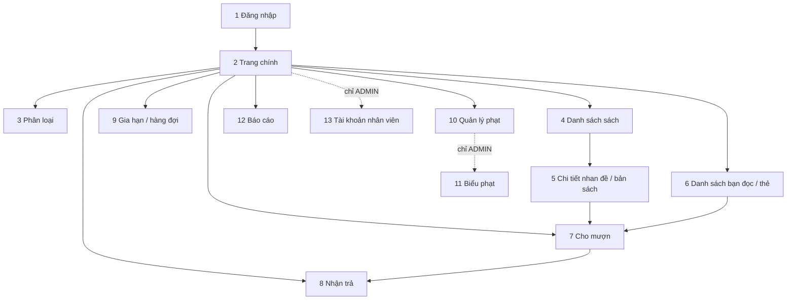

# Danh mục màn hình và điều hướng Android Admin (P3)

> Bản nháp tuần 9. Đây là phạm vi cuối kỳ, không phải yêu cầu lập trình xong trong tuần 9.
> Màn hình ưu tiên nối API thật ở mốc tuần 11: Đăng nhập và Danh sách sách.
> Menu hiển thị theo vaiTro chỉ hỗ trợ giao diện; backend vẫn phải chặn trái quyền (403).

## 1. Danh mục màn hình

| STT | Màn hình | Vai trò | Ghi chú |
|---|---|---|---|
| 1 | Đăng nhập | ADMIN, THU_THU | Ưu tiên nối API tuần 11 |
| 2 | Trang chính (menu chức năng) | ADMIN, THU_THU | Menu ẩn/hiện theo vaiTro |
| 3 | Phân loại | ADMIN, THU_THU | |
| 4 | Danh sách sách | ADMIN, THU_THU | **RecyclerView 1**; ưu tiên nối API tuần 11 |
| 5 | Chi tiết nhan đề / bản sách | ADMIN, THU_THU | Hiện maCaBiet, viTriKe, trangThai của từng bản |
| 6 | Danh sách bạn đọc / thẻ | ADMIN, THU_THU | **RecyclerView 2** |
| 7 | Cho mượn | ADMIN, THU_THU | Nhập hoặc quét mã thẻ và mã cá biệt, màn xác nhận, kết quả |
| 8 | Nhận trả | ADMIN, THU_THU | Kết quả có phạt hoặc không, có giữ chỗ hoặc không |
| 9 | Gia hạn / hàng đợi | ADMIN, THU_THU | Phạm vi endpoint chờ chốt |
| 10 | Quản lý phạt (thu phạt) | ADMIN, THU_THU | |
| 11 | Biểu phạt (tạo phiên bản mới) | **Chỉ ADMIN** | Có thể là phần riêng trong màn Quản lý phạt |
| 12 | Báo cáo | ADMIN, THU_THU | **Vị trí biểu đồ** |
| 13 | Tài khoản nhân viên | **Chỉ ADMIN** | |

## 2. Đánh dấu đặc biệt
- **Chỉ ADMIN:** màn 11 (Biểu phạt) và màn 13 (Tài khoản nhân viên).
- **Hai danh sách dùng RecyclerView:** màn 4 (sách) và màn 6 (bạn đọc).
- **Biểu đồ báo cáo:** nằm ở màn 12 (Báo cáo). Chart thật chưa làm trong tuần 9.
- **Camera quét mã** dự kiến ở màn 7 và 8, kèm nhập tay dự phòng. Chưa yêu cầu chạy thật tuần 9.

## 3. Sơ đồ điều hướng

Lỗi 401 từ bất kỳ màn nào: về màn 1. Lỗi 403: báo thiếu quyền, ở lại màn hiện tại.

## 4. Kiểm tra bao phủ
- Có 13 màn (tối thiểu 6).
- Đủ chức năng bắt buộc: đăng nhập, danh mục, sách, bạn đọc/thẻ, mượn, trả, gia hạn/hàng đợi, phạt, báo cáo, nhân viên.

## 5. Chờ chốt (hỏi P2, P1)
- Gia hạn và hàng đợi có cần màn riêng hay gộp vào chi tiết phiếu mượn?
- Biểu phạt là màn riêng hay phần trong Quản lý phạt?
- Màn Phân loại cần thêm/sửa/xóa hay chỉ xem?
