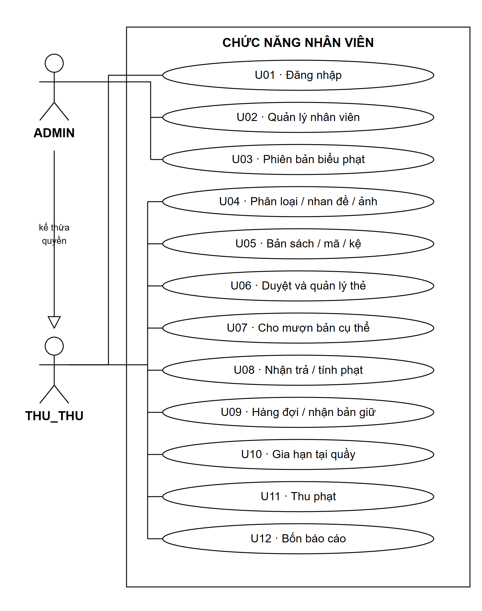
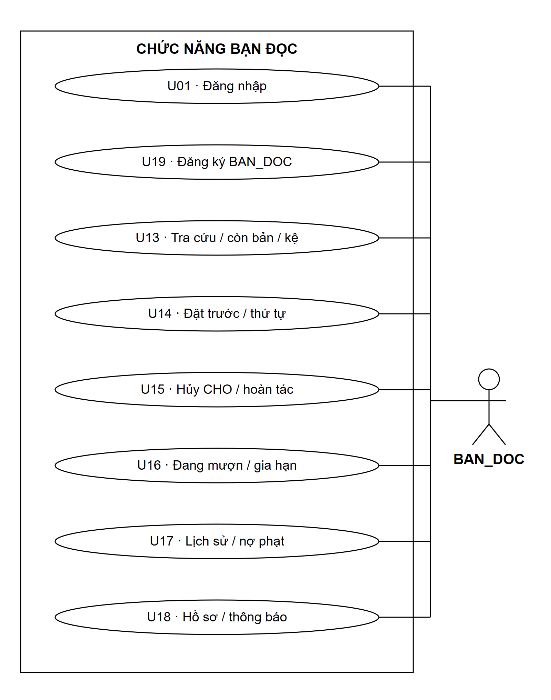
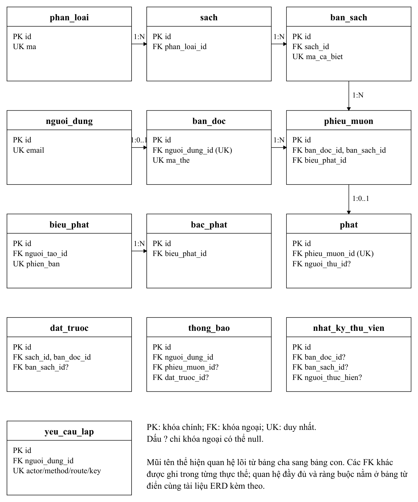

# Báo cáo phân tích hệ thống quản lý thư viện trường học

**Môn học:** Lập trình thiết bị di động - INT4211  
**Đề tài:** 21 - Hệ thống quản lý thư viện trường học  
**Mốc thực hiện:** Tuần 9 - Chốt phân tích  
**Ngày lập bản nháp:** 06/11/2026

> Bản PDF gốc: [BaoCao_PhanTich_Tuan9.pdf](../BaoCao_PhanTich_Tuan9.pdf)

| Thông tin nhóm | Nội dung |
|---|---|
| Mã nhóm / lớp | ____________ |
| Thành viên 1 / MSSV | Huỳnh Triệu Hào 231A290088 |
| Thành viên 2 / MSSV - nhóm trưởng | Võ Văn Quốc Bảo 231A290036 |
| Thành viên 3 / MSSV | Võ Anh Lộc 231A290093 |
| Thành viên 4 / MSSV | Nguyễn Đức Quang 231A290025 |

## Mục lục

1. [Phạm vi hệ thống](#1-phạm-vi-hệ-thống)
2. [Tác nhân và use case](#2-tác-nhân-và-use-case)
3. [Mô hình cơ sở dữ liệu](#3-mô-hình-cơ-sở-dữ-liệu)
4. [Quy tắc nghiệp vụ và trao đổi dữ liệu](#4-quy-tắc-nghiệp-vụ-và-trao-đổi-dữ-liệu)
5. [Phân công và tiến độ](#5-phân-công-và-tiến-độ)
6. [Tài liệu tham khảo](#6-tài-liệu-tham-khảo)

## 1. Phạm vi hệ thống

Thư viện cần quản lý được từng bản sách, theo dõi người đang mượn và xử lý hàng đợi khi sách hết bản. Bạn đọc cần biết sách còn hay hết, vị trí kệ, hạn trả và khoản phạt của mình. Hệ thống được phân tích theo ba thành phần: ứng dụng Android dành cho nhân viên, ứng dụng Flutter dành cho bạn đọc và backend dùng chung một cơ sở dữ liệu PostgreSQL.

Android sử dụng Java và XML; Flutter sử dụng Dart; backend sử dụng Node.js, Express và thư viện pg. Cơ sở dữ liệu và ảnh bìa dự kiến đặt trên Supabase, backend triển khai trên Render theo công nghệ của đề. Hai ứng dụng trao đổi dữ liệu qua REST API. Việc xác thực, kiểm quyền, kiểm giới hạn mượn, tính phạt và chuyển trạng thái do backend xử lý.

Phạm vi gồm danh mục, bản sách, thẻ bạn đọc, mượn trả, gia hạn, đặt trước, giữ chỗ, phạt, thông báo và bốn báo cáo. Bản cơ bản nhận trả sách còn tốt, thu toàn bộ một khoản phạt tại quầy. Quy trình mất/hỏng khi đang mượn, thanh toán trực tuyến, thu từng phần và nhiều chi nhánh chưa được đưa vào phạm vi này.

Báo cáo trình bày thiết kế tại mốc tuần 9. Ba đầu ra là sơ đồ use case, sơ đồ cơ sở dữ liệu và bảng phân công bản nháp. Kết quả chạy API, cơ sở dữ liệu, ứng dụng và kiểm thử sẽ được ghi nhận ở các mốc triển khai sau.

## 2. Tác nhân và use case

Hệ thống có ba vai trò. ADMIN quản lý nhân viên, biểu phạt và có quyền thực hiện nghiệp vụ của thủ thư. THU_THU quản lý danh mục, bản sách, thẻ, lưu thông, thu phạt và xem báo cáo. BAN_DOC tra cứu và thao tác với dữ liệu cá nhân. Người chưa có tài khoản được đăng ký bạn đọc; tài khoản nhân viên do ADMIN tạo.

  

<em>Hình 1a. Use case của nhân viên; ADMIN kế thừa quyền THU_THU.</em>

  

<em>Hình 1b. Use case bạn đọc; đăng ký tách khỏi đăng nhập.</em>

Danh mục use case bao gồm xác thực, quản lý nhân viên và biểu phạt, quản lý sách/bản/thẻ, nghiệp vụ tại quầy, báo cáo và các chức năng bạn đọc. Bảy tình huống sau là cơ sở thiết kế nghiệp vụ.

**UC01 - Cho mượn bản sách.** Nhân viên xác định bạn đọc bằng mã thẻ và bản sách bằng mã cá biệt. Backend kiểm hạn thẻ, trạng thái khóa, nợ, phiếu quá hạn, số phiếu mở và quyền nhận bản đang giữ. Nếu hợp lệ, hệ thống lập phiếu, ghi hạn và chuyển bản sang `DANG_MUON` trong cùng transaction. Nếu bản vừa được mượn hoặc bạn đọc không đủ điều kiện, yêu cầu bị từ chối và dữ liệu giữ nguyên. Kết quả phải hiển thị thống nhất trên cả hai ứng dụng.

**UC02 - Nhận trả và tính phạt.** Nhân viên tìm phiếu đang mở và xác nhận trả. Hệ thống tính số ngày quá hạn, áp dụng biểu phạt đã lưu lúc mượn, đóng phiếu và tạo khoản phạt nếu có. Bản trả được cấp cho hàng đợi hoặc chuyển rảnh. Bạn đọc có thẻ hết hạn, bị khóa hoặc còn nợ vẫn được trả sách. Gửi lại thao tác trả không tạo thêm khoản phạt hoặc cấp giữ lần nữa.

**UC03 - Đặt trước theo nhan đề.** Bạn đọc được đặt khi nhan đề không còn bản rảnh, không đang mượn cùng nhan đề và không có lượt đặt hiệu lực trùng. Danh tính lấy từ token. Hệ thống tạo lượt `CHO`, xếp theo thời điểm đặt rồi ID và trả vị trí hiện tại. Khi có bản trả, người đầu còn đủ điều kiện được giữ. Người mất điều kiện được kết thúc lượt kèm lý do trước khi xét người tiếp theo.

**UC04 - Nhận sách đã giữ.** Nhân viên cho đúng bạn đọc nhận bản trong thời gian giữ còn hiệu lực. Hệ thống kiểm lại điều kiện mượn, tạo phiếu và chuyển lượt đặt sang `DA_NHAN`. Người khác không được mượn bản này. Khi hết 48 giờ, lượt chuyển `HET_HAN`; người tiếp theo được một khoảng giữ mới tính từ lúc cấp thực tế. Nếu không còn người hợp lệ, bản trở lại `RANH`.

**UC05 - Gia hạn.** Chủ phiếu hoặc nhân viên được yêu cầu gia hạn khi phiếu còn mở, chưa quá hạn, thẻ hợp lệ, không nợ và nhan đề không có người đặt. Backend kiểm lại tại thời điểm cập nhật, tăng hạn và số lần nguyên tử. Nếu vừa có người đặt hoặc đã hết lượt, hệ thống trả lý do từ chối. Sau gia hạn, lịch nhắc trên ứng dụng phải đổi theo hạn mới.

**UC06 - Hủy và hoàn tác lượt chờ.** Bạn đọc xác nhận hủy lượt `CHO` của mình. Hệ thống xóa logic để giữ lịch sử và trả thời điểm hết quyền hoàn tác. Khi người dùng chọn Hoàn tác, backend kiểm lại điều kiện đặt rồi phục hồi ở cuối hàng với thời điểm mới. Quá cửa sổ, sách đã rảnh hoặc chính người đó đã tạo lượt hiệu lực mới cùng nhan đề thì không phục hồi. Lượt `GIU_CHO` chưa hỗ trợ hủy trong bản cơ bản.

**UC07 - Thu phạt.** Nhân viên xem khoản đã chốt, xác nhận thu toàn bộ và gửi yêu cầu không kèm số tiền do app quyết định. Backend lấy tiền từ dữ liệu đã lưu, ghi người thu, thời điểm và nhật ký. Khoản đã thu được trả lại hiện trạng khi thao tác lặp. Hết nợ không tự xóa khóa thủ công hoặc bỏ qua phiếu khác đang quá hạn.

## 3. Mô hình cơ sở dữ liệu

Mô hình tách SÁCH và BẢN_SÁCH: sách chứa thông tin nhan đề; bản sách chứa mã cá biệt, tình trạng và kệ. Phiếu mượn tham chiếu bản vật lý, còn đặt trước tham chiếu nhan đề. Một bản có nhiều lần mượn trong lịch sử nhưng chỉ có tối đa một phiếu chưa trả.

  

<em>Hình 2. Quan hệ lõi và khóa của 13 thực thể trong mô hình thư viện.</em>

| Thực thể | Vai trò | Khóa và quan hệ chính |
|---|---|---|
| `nguoi_dung` | Xác thực và vai trò | PK id; email duy nhất |
| `phan_loai` | Danh mục phân loại | PK id; mã duy nhất |
| `sach` | Metadata nhan đề | PK id; FK phan_loai_id |
| `ban_sach` | Bản vật lý | PK id; FK sach_id; mã cá biệt duy nhất |
| `ban_doc` | Hồ sơ và thẻ | PK id; FK nguoi_dung_id duy nhất; mã thẻ duy nhất |
| `phieu_muon` | Mượn, hạn và trả | PK id; FK bạn đọc, bản sách, phiên bản biểu phạt |
| `dat_truoc` | Hàng đợi và giữ chỗ | PK id; FK sách, bạn đọc; bản sách có thể null khi CHO |
| `bieu_phat` | Phiên bản biểu phạt | PK id; FK người tạo; mã phiên bản duy nhất |
| `bac_phat` | Khoảng ngày và mức tiền | PK id; FK bieu_phat_id |
| `phat` | Khoản phạt chính thức | PK id; FK phieu_muon_id duy nhất; người thu có thể null |
| `nhat_ky_thu_vien` | Lịch sử sự kiện | PK id; FK người thực hiện, bạn đọc/bản khi liên quan |
| `thong_bao` | Thông báo của từng người | PK id; FK người nhận; phiếu/lượt đặt tùy loại |
| `yeu_cau_lap` | Chống lặp yêu cầu | PK id; FK người thao tác; khóa theo actor, method, route và key |

Một tài khoản có tối đa một hồ sơ bạn đọc. Một phân loại có nhiều nhan đề; một nhan đề có nhiều bản và nhiều lượt đặt. Một phiếu có tối đa một khoản phạt. Khi lượt đặt ở `GIU_CHO`, bản được cấp phải thuộc đúng nhan đề và không đồng thời giữ cho người khác.

Bảng `bac_phat` được tách khỏi `bieu_phat` để giữ các bậc theo phiên bản. Phiếu lưu phiên bản lúc mượn; khoản phạt lưu phép tính khi trả. Nhờ đó, thay biểu phạt không đổi số tiền lịch sử. Đây là phương án thiết kế cần nhóm xác nhận trước khi tạo migration.

ID dùng UUID; hạn thẻ và hạn trả dùng DATE theo Việt Nam; thời điểm dùng UTC; tiền là số nguyên VNĐ. Các trường số bản rảnh, tổng nợ, khả năng gia hạn và vị trí hàng đợi được tính ở backend. Không xóa cascade lịch sử mượn. Những ràng buộc một phiếu mở mỗi bản, một lượt hiệu lực mỗi người/nhan đề và một khoản phạt mỗi phiếu cần được bảo vệ bằng unique index cùng transaction.

## 4. Quy tắc nghiệp vụ và trao đổi dữ liệu

Theo đề 21, khi có bản trả, hệ thống xét hàng đợi và giữ cho người đầu đủ điều kiện trong 48 giờ. Gia hạn bị chặn nếu có người đặt. Bạn đọc được nhắc trước hạn 2 ngày và khi quá hạn. Phạt phải tính theo bậc thang.

Các thông số sau được đề xuất cho bản thiết kế và chờ cả nhóm thống nhất:

| Nội dung | Phương án phân tích |
|---|---|
| Mượn và giới hạn | 14 ngày, mặc định 5 phiếu mở; có thể cấu hình giới hạn trên thẻ |
| Thẻ gần hết hạn | Hạn trả bằng min(ngày mượn +14, hạn thẻ) |
| Gia hạn | Một lần thêm 7 ngày; từ chối nếu vượt hạn thẻ |
| Lượt giữ | Chưa tính là phiếu mở; kiểm lại số phiếu khi cấp giữ và khi nhận |
| Hoàn tác | Trong 10 giây, chỉ lượt CHO, phục hồi cuối hàng |
| Biểu phạt | Ngày 1-3: 1.000đ/ngày; 4-7: 2.000đ; từ ngày 8: 5.000đ, cộng dồn |
| Giờ nhắc | 08:00 Việt Nam |

Đến hết ngày hạn chưa tính quá hạn. Trả sang ngày tiếp theo tính một ngày; không lấy số mili giây chia 24 giờ để xác định ngày lịch. Theo biểu dự kiến, quá hạn 10 ngày là 3×1.000 + 4×2.000 + 3×5.000 = 26.000đ. Phiếu đang mở chỉ hiển thị tiền dự kiến; khoản phải thu được chốt khi trả.

Luồng ghi cần cập nhật phiếu, bản, hàng đợi, nhật ký và kết quả chống lặp trong cùng transaction. Hai request cùng bản chỉ được tạo một phiếu mở. Hai request khác bản của một bạn đọc cũng phải kiểm lại giới hạn trong khóa nghiệp vụ. Khi app hết thời gian chờ, retry cùng ý định dùng lại `Idempotency-Key`; không tự tạo key mới để gửi lại giao dịch.

Hai ứng dụng dùng chung JSON: ID dạng chuỗi, `data` cho kết quả, `meta` cho phân trang, `error` cho lỗi. API cá nhân lấy danh tính từ token và kiểm quyền sở hữu. Bốn báo cáo được phân biệt rõ: số lượt mượn theo ngày mượn; tỷ lệ quá hạn trên nhóm phiếu mượn trong kỳ; nhan đề chưa từng có phiếu; tiền phát sinh, tiền đã thu trong kỳ và nợ hiện tại. Nhắc hạn lưu thông báo trong DB, phối hợp lịch cục bộ trên Flutter và hủy lịch cũ khi gia hạn/trả.

## 5. Phân công và tiến độ

| Vai trò | Thành viên | Phần phụ trách và bàn giao | Review | Tỷ lệ dự kiến |
|---|---|---|---|---|
| P1 - Backend nền tảng | Quang | Kiến trúc, auth, danh mục/thẻ, từ điển; tổng hợp ERD/API/migration | P2; P3/P4 rà dữ liệu | 25% |
| P2 - Nghiệp vụ, nhóm trưởng | Bảo | Use case, chính sách, lưu thông/phạt/hàng đợi, báo cáo/nhắc; tổng hợp phân công | P1 rà dữ liệu; P3/P4 rà luồng | 25% |
| P3 - Android Admin | Lộc | Màn hình/luồng nhân viên, wireframe, nhu cầu API và biểu đồ | P2 nghiệp vụ, P1 API | 25% |
| P4 - Flutter Client | Hào | Màn hình/luồng bạn đọc, đặt/gia hạn/undo và nhắc | P2 nghiệp vụ, P1 API | 25% |

Tỷ lệ là phân bổ dự kiến, chưa thay đánh giá đóng góp và chữ ký. Bảng xác nhận từng thành viên nằm trong tài liệu phân công kèm theo.

Đầu tuần 9 thống nhất phạm vi, tác nhân và câu hỏi nghiệp vụ. Giữa tuần ghép use case, ERD và yêu cầu dữ liệu của hai giao diện. Cuối tuần review ba đầu ra, bổ sung thông tin thật và nộp bản nháp theo hướng dẫn lớp.

Sau mốc phân tích, P1 bàn giao khung dùng chung cho P2; P1/P2 chốt JSON với P3/P4 trước khi tích hợp. Tuần 11 cần backend deploy, ít nhất ba API thật và hai màn hình mỗi app; tuần 13 demo nghiệp vụ chính; tuần 15 bảo vệ. Mỗi người dùng GitHub riêng, ít nhất 15 commit có ý nghĩa rải đều toàn kỳ, ghi đúng người thực hiện và giải thích được phần mình khi bảo vệ.

## 6. Tài liệu tham khảo

1. **DoAn_INT4211_QuanLyThuVienTruongHoc.pdf.** Phần B-E và đề 21 trang 8-9; căn cứ yêu cầu, ba đầu ra tuần 9 và quy định đóng góp.
2. **DoAn_CuoiKy_GioiThieu_INT4211.pdf.** Các slide công nghệ, lịch nộp và điểm cá nhân.
3. **01_Nguoi1_Backend_NenTang.docx.** Phạm vi nền tảng, dữ liệu, xác thực và hợp đồng LIB21-v1.
4. **02_Nguoi2_Backend_NghiepVu.docx.** Mượn trả, gia hạn, hàng đợi, phạt, báo cáo và nhắc hạn.
5. **03_Nguoi3_Android_Admin.docx.** Luồng nhân viên, phân quyền, màn hình, báo cáo và quét mã.
6. **04_Nguoi4_Flutter_Client.docx.** Luồng bạn đọc, tra cứu, đặt/gia hạn, hoàn tác và nhắc hạn.

Các sơ đồ nguồn, mô tả use case chi tiết, inventory API và bảng đối chiếu nằm trong thư mục tài liệu kèm theo. Những chính sách dự kiến cần được cả nhóm thống nhất trước khi triển khai.
